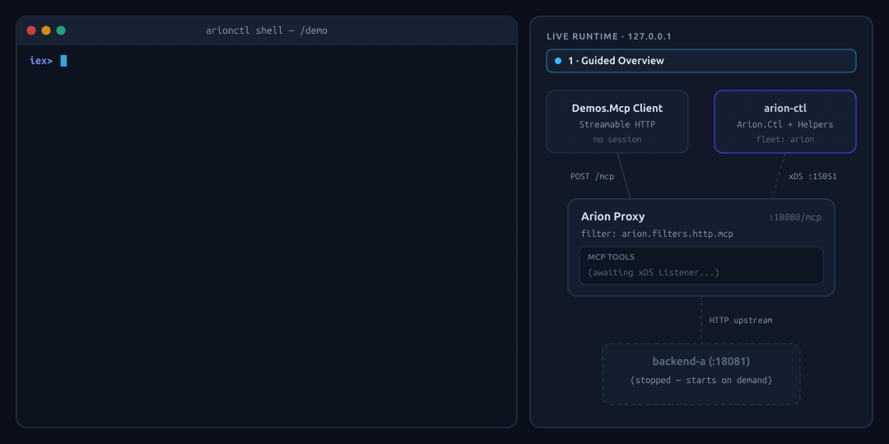

# Arion demos

Interactive examples for exploring [Arion](https://github.com/arion-gateway/arion)
and `arion-ctl`. Start the proxy and control plane once with Docker Compose, attach
to the interactive shell, and drive each demo live over xDS.



## Quick start

Requirements: **Docker** (with Docker Compose).

```sh
docker compose up -d
docker compose exec -it arion-ctl /app/bin/arionctl shell
```

Inside the shell, the `Demo` guide and all demo modules load automatically:

```elixir
Demo.list()                  # list available demos
Demo.open(:mcp)              # view the guided steps & commands for a demo
Demo.show(:mcp, :setup)      # read a step's source code before running it
Demos.Mcp.setup()            # run the step (prints a "Next →" nudge)
Demo.hint()                  # re-show the current "Next →" nudge anytime
Demo.run(:mcp)               # or sweep through the full demo unattended
```

You can send requests right from IEx (`Demo.get/2`, `Demo.post/3`) or from your host
terminal with plain `curl`:

```sh
curl http://localhost:18080/hello
```

When finished, press **Ctrl+G** then `q` + Enter to detach from the shell, and stop
the containers with `docker compose down`.

## Demos

Each demo lives in its own `demo.exs` module with domain-named, parameterized
functions you drive directly—plus a `run/0` function for unattended execution.

| Demo | Open / Run in shell | What you drive |
| --- | --- | --- |
| [HTTP basics](demos/http/README.md) | `Demo.open(:http)` / `Demo.run(:http)` | Publish Cluster + Listener, then swap backends live over xDS |
| [Routing](demos/routing/README.md) | `Demo.open(:routing)` / `Demo.run(:routing)` | RDS route table, prefix rewrites, headers, query params, redirects, direct responses |
| [TLS](demos/tls/README.md) | `Demo.open(:tls)` / `Demo.run(:tls)` | Publish xDS `Secret`, bind HTTPS listener via SDS, rotate certificate live |
| [Load balancing](demos/load-balancing/README.md) | `Demo.open(:load_balancing)` / `Demo.run(:load_balancing)` | `ROUND_ROBIN`, `sample/1`, `LEAST_REQUEST`, parameterized `weighted/2` splits |
| [RBAC](demos/rbac/README.md) | `Demo.open(:rbac)` / `Demo.run(:rbac)` | Public path rule + parameterized `allow_role/1` updates |
| [MCP gateway](demos/mcp/README.md) | `Demo.open(:mcp)` / `Demo.run(:mcp)` | `connect/0`, `list_tools/1`, `call_tool/3`, and live `add_echo_tool/0` over xDS |
| [Retries and timeouts](demos/traffic/README.md) | `Demo.open(:traffic)` / `Demo.run(:traffic)` | Retry `5xx` responses and tune `set_slow_timeout/1` live |
| [Access logs](demos/access-logs/README.md) | `Demo.open(:access_logs)` / `Demo.run(:access_logs)` | Enable stdout access logs and customize `set_format/1` live |

## Shell utilities

```elixir
Demo.show(:routing)                    # print the entire demos/routing/demo.exs file
Demo.show(:routing, :add_prefix_rewrite) # print a single function's source
Demo.hint()                            # re-display the latest "Next →" guidance
Demo.reload(:routing)                  # recompile demos/routing/demo.exs after editing
Demo.start_backend(18083, "backend-c") # spin up extra mock backends on demand
Demo.stop_backend(18081)               # stop a backend to observe proxy behavior
Demo.backends()                        # list running demo backends
Demo.reset()                           # clear fleet "arion" and stop demo backends
Arion.Ctl.status()                     # inspect proxy ACK/NACK state
```

## Exporting your configuration

Any configuration built in the shell is stored by `arion-ctl` and can be exported
as standard resource definitions (JSON/YAML) for use elsewhere:

```sh
docker compose exec arion-ctl /app/bin/arionctl get --fleet arion > config.json
```

Or from inside the shell: `Demo.export("config.json")`. You can apply the exported
file to any standalone `arion-ctl` instance with `arionctl apply -f config.json` —
see the [arion-ctl standalone guide](https://github.com/arion-gateway/arion-ctl/blob/main/docs/standalone-walkthrough.md)
and [configuration reference](https://github.com/arion-gateway/arion-ctl/blob/main/docs/configuration-reference.md).

## Architecture

```text
curl / Demo.get() → Arion :18080 (HTTP) or :18443 (TLS)
                      ├── backend-a :18081  (started on demand)
                      └── backend-b :18082  (started on demand)
                    ↑ configuration over xDS
                    arion-ctl :15051
```

Both containers share a loopback network namespace so addresses stay `127.0.0.1`
everywhere. Proxy logs are visible via `docker compose logs -f arion`.

See [docs/development.md](docs/development.md) to override container image tags or
run against local builds without Docker.
